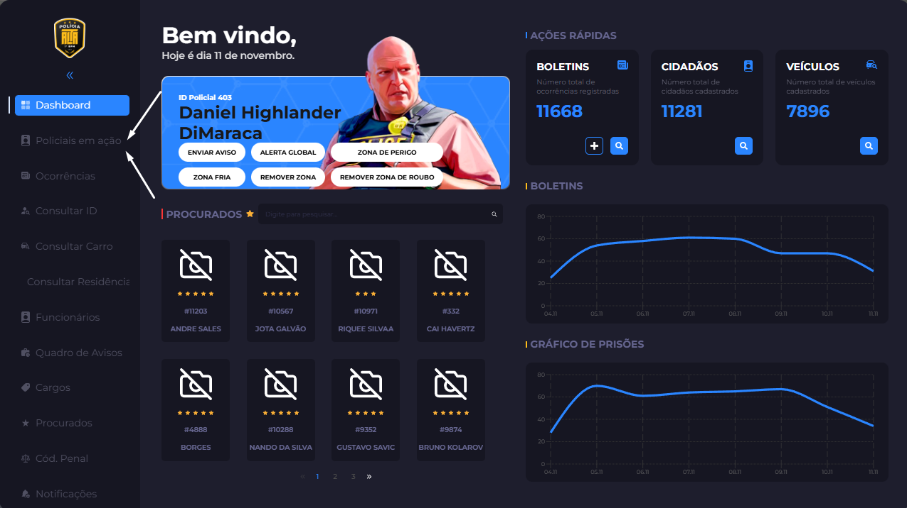
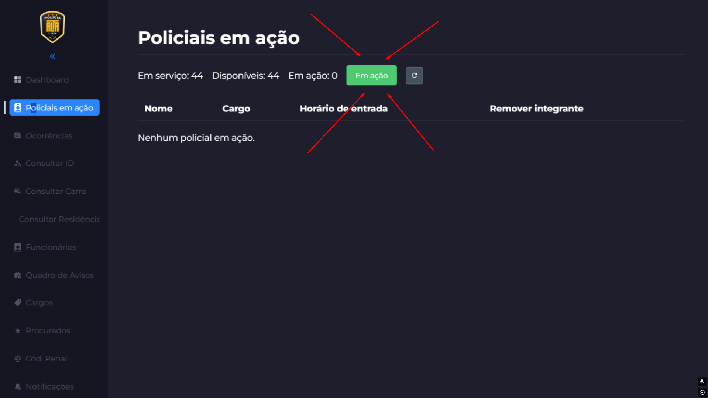

# Oficiais em Ação

Todo oficial que estiver participando de uma ação deverá utilizar o ponto de ação, acessando a aba “Policiais em ação” no tablet da polícia e clicando em “Em ação”.


O ponto de ação deve ser utilizado exclusivamente durante ações e desativado assim que a participação do oficial terminar.


<figure><figcaption></figcaption></figure>

<figure><figcaption></figcaption></figure>
